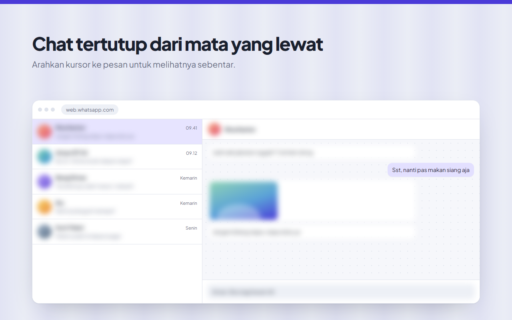

<p align="center"></p>

<h1 align="center">Tirai: Privasi untuk WhatsApp Web</h1>

<p align="center">Blur chat, foto, nama, dan foto profil di WhatsApp Web. Arahkan kursor untuk melihat, kunci dengan PIN saat ditinggal.</p>

<p align="center"><a href="https://yudadwiptr.github.io/privacywaweb/">Situs</a> · <a href="https://yudadwiptr.github.io/privacywaweb/privacy.html">Kebijakan privasi</a> · <a href="https://github.com/yudadwiptr/privacywaweb/issues">Laporkan masalah</a></p>



Ekstensi browser (Manifest V3) untuk Chrome, Edge, Brave, Opera, dan Firefox. Tidak membaca, menyimpan, atau mengirim isi chat. Tidak ada server, analitik, atau request ke luar.

## Pasang (mode developer)

1. Unduh repositori ini (Code → Download ZIP) lalu ekstrak, atau `git clone`
2. Buka `chrome://extensions` (Edge: `edge://extensions`)
3. Nyalakan **Developer mode**
4. Klik **Load unpacked**, pilih folder ini
5. Buka https://web.whatsapp.com, lalu klik ikon Tirai di toolbar

Pintasan (bisa diubah di `chrome://extensions/shortcuts`):

- `Alt+Shift+B` membuka/menutup tirai blur
- `Alt+Shift+L` mengunci WhatsApp Web sekarang

## Yang bisa diburamkan

Isi pesan, pratinjau pesan terakhir, kolom ketik, foto dan video di chat, galeri media, foto profil, serta nama kontak dan grup. Masing-masing bisa dinyalakan sendiri, dengan opsi "lihat saat kursor di atasnya". Ada juga blur seluruh layar saat ditinggal, mode "buka saat kursor di WhatsApp", dan pengatur ketebalan blur.

## Kunci layar dengan PIN

Atur PIN (4–8 angka) di popup, bagian **Kunci layar**. Saat terkunci, isi WhatsApp Web disembunyikan dan diganti layar PIN di semua tab WhatsApp.

WhatsApp Web terkunci ketika:

- kamu menekan **Kunci** di popup atau `Alt+Shift+L`
- tidak ada aktivitas selama waktu yang dipilih (1 menit sampai 1 jam, atau tidak pernah)
- browser dibuka ulang (bisa dimatikan)
- tab WhatsApp dibuka lagi setelah waktu tidak aktif terlewati

Setiap 5 kali PIN salah, input ditahan 30 detik, lalu 1 menit, 2 menit, dan seterusnya (maksimal 15 menit). Hal yang sama berlaku untuk **Ganti PIN** dan **Matikan kunci** di popup.

PIN tidak pernah disimpan. Yang disimpan hanya hash PBKDF2-SHA256 dengan salt acak di `chrome.storage.local`, yang tidak bisa dibaca halaman web.

**Batasannya:** kunci ini melindungi dari orang yang sekadar melihat atau memakai komputermu sebentar. Orang yang paham bisa mematikan ekstensi lewat `chrome://extensions` atau membuka DevTools. Untuk perlindungan penuh, kunci juga komputermu (`Win+L`). Notifikasi WhatsApp di desktop tetap muncul saat terkunci, jadi matikan pratinjau notifikasi di pengaturan WhatsApp kalau perlu.

Lupa PIN? Hapus lalu pasang ulang ekstensi Tirai untuk mengatur PIN baru.

## Rilis ke store

```bash
python tools/build.py
```

Menghasilkan dua paket di `dist/`:

| Paket | Untuk |
| --- | --- |
| `tirai-chrome-<versi>.zip` | Chrome Web Store, Microsoft Edge Add-ons, Opera Add-ons |
| `tirai-firefox-<versi>.zip` | Firefox Add-ons (AMO) |

Teks listing (Indonesia dan Inggris), jawaban form privasi Chrome Web Store, dan daftar gambar yang dibutuhkan ada di [`store/listing.md`](store/listing.md). Gambar promo dan screenshot ada di `store/images/`.

Sebelum rilis versi baru, naikkan `version` di `manifest.json`.

## Situs (GitHub Pages)

Folder `docs/` berisi landing page dengan SEO (meta tag, Open Graph, JSON-LD, sitemap, robots), favicon, dan kebijakan privasi. Aktifkan di **Settings → Pages → Deploy from a branch → `main` / `docs`**. Alamatnya akan menjadi https://yudadwiptr.github.io/privacywaweb/.

## Struktur

| File | Isi |
| --- | --- |
| `manifest.json` | Konfigurasi ekstensi (Chrome + Firefox) |
| `_locales/` | Nama dan deskripsi ekstensi dalam bahasa Indonesia dan Inggris |
| `shared/defaults.js` | Pengaturan bawaan, dipakai popup, content script, dan background |
| `shared/lock.js` | Hash PIN, batas percobaan, dan status kunci |
| `content/content.js` | Membangun satu `<style>` blur dari pengaturan, plus deteksi idle |
| `content/lock.js` | Layar PIN di WhatsApp Web dan kunci otomatis |
| `popup/` | Tampilan popup, termasuk panel "Kunci layar" (`lock-panel.js`) |
| `background.js` | Badge "off", pintasan keyboard, dan kunci saat browser dibuka |
| `fonts/` | Plus Jakarta Sans (SIL OFL), dibundel supaya tidak ada request ke Google Fonts |
| `icons/` | Ikon ekstensi 16/32/48/128 |
| `assets/brand/logo.svg` | Logo sumber |
| `docs/` | Landing page, kebijakan privasi, favicon, gambar OG |
| `store/` | Teks listing, gambar promo, dan sumber HTML-nya |
| `tools/make_icons.py` | Membuat ulang semua ikon dan favicon |
| `tools/render-promo.ps1` | Merender gambar OG, tile promo, dan screenshot store dengan Chrome headless |
| `tools/build.py` | Membuat ZIP untuk tiap store |
| `tools/lock-preview.html` | Halaman uji layar kunci tanpa memasang ekstensi |
| `tools/media-test.html` | Halaman uji blur foto tanpa memasang ekstensi |
| `tools/diagnose-wa.js` | Skrip Console untuk melaporkan struktur WhatsApp Web (tanpa isi chat) |

## Kalau ada bagian yang tidak ter-blur

WhatsApp Web sering mengganti struktur HTML-nya. Semua selector ada di objek `SELECTORS` di `content/content.js`. Inspect elemen yang lolos di DevTools, lalu tambahkan selector-nya ke kategori yang sesuai. Selector yang tidak valid atau tidak cocok diabaikan dengan aman karena dibungkus `:is()`.

Cara cepat: buka chat yang ada fotonya, tempel isi `tools/diagnose-wa.js` di DevTools Console, lalu kirim laporan JSON yang tersalin ke clipboard. Laporan itu hanya berisi nama tag, atribut, dan class, tanpa isi chat.

Foto dan video dikenali dari sumbernya (`blob:`, CDN media WhatsApp, atau thumbnail JPEG), bukan dari class, jadi lebih tahan terhadap perubahan tampilan WhatsApp.

## Pratinjau tanpa memasang ekstensi

```bash
python -m http.server 5178
```

- Popup: http://localhost:5178/popup/popup.html (pengaturan disimpan ke `localStorage`)
- Layar kunci: http://localhost:5178/tools/lock-preview.html
- Situs: http://localhost:5178/docs/

---

Tirai adalah proyek independen dan tidak berafiliasi dengan WhatsApp atau Meta. WhatsApp adalah merek dagang milik WhatsApp LLC.
